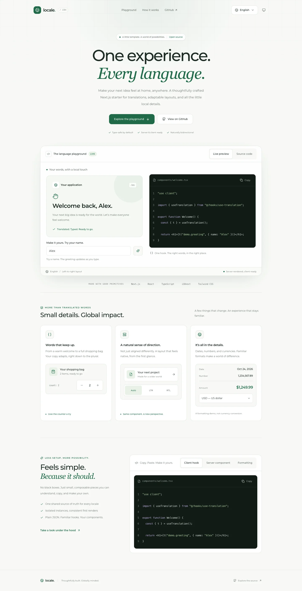
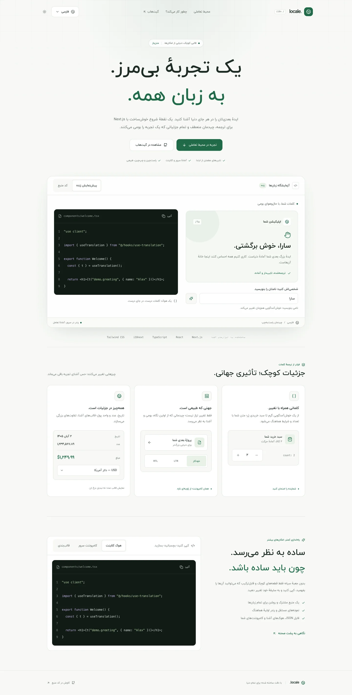
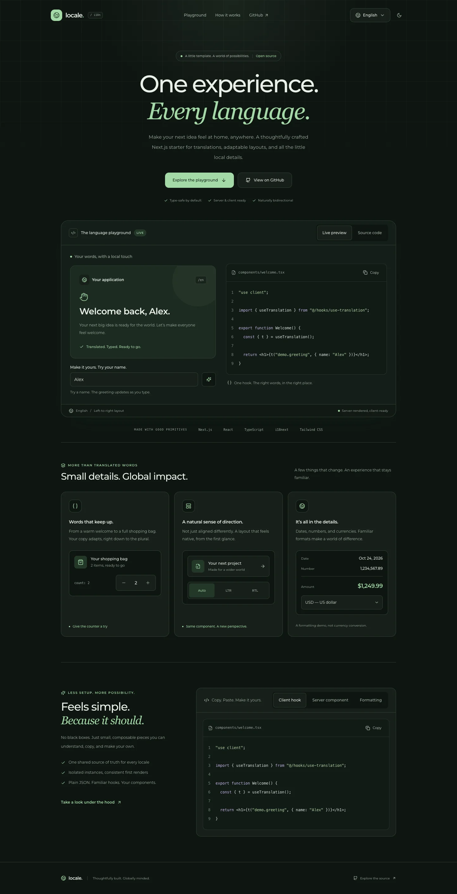
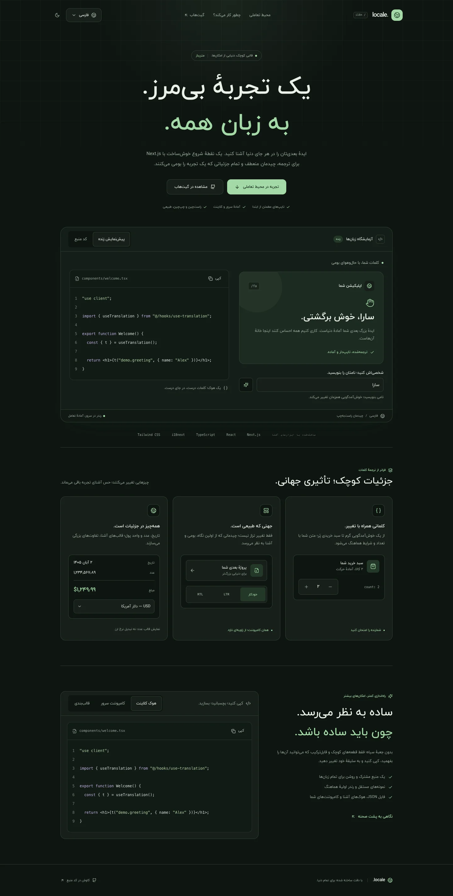

# Next.js + React Internationalization Template

A TypeScript starting point for locale-prefixed Next.js applications, powered by
**i18next** and **react-i18next**. Translate Server and Client Components, render
Persian right-to-left and English left-to-right, and keep translation infrastructure
separate from routes and UI.

## Visual Tour

Real captures of the included playground, showing the same components in English
(left-to-right) and Persian (right-to-left). Open an image for the full-resolution view.

<table>
  <tr>
    <th>English · LTR · Light</th>
    <th>Persian · RTL · Light</th>
  </tr>
  <tr>
    <td></td>
    <td></td>
  </tr>
  <tr>
    <th>English · LTR · Dark</th>
    <th>Persian · RTL · Dark</th>
  </tr>
  <tr>
    <td></td>
    <td></td>
  </tr>
</table>

Try the **language menu** to switch `/en` ↔ `/fa`, the **theme menu** for
Light/Dark/System, and the **Auto/LTR/RTL controls** to preview component direction.
Switching language preserves the current path and query parameters. Theme choice
persists across locale navigation.

[Refresh screenshots and icons](docs/visual-assets.md) ·
[Cleanup inventory](docs/cleanup.md)

## Contents

- [Visual tour](#visual-tour)
- [Branding and icons](#branding-and-icons)
- [Key features](#key-features)
- [Interactive demo](#interactive-demo)
- [Tech stack](#tech-stack)
- [Quick start](#quick-start)
- [Folder structure](#folder-structure)
- [How internationalization works](#how-internationalization-works)
- [Step-by-step integration](#step-by-step-integration)
- [Translation maintenance](#translation-maintenance)
- [Migration from the previous layout](#migration-from-the-previous-layout)
- [Development and verification](#development-and-verification)
- [Contributing](#contributing)
- [License](#license)

## Key Features

- **App Router architecture:** localized routes live in `app/[lng]`.
- **Server-first rendering:** translate page content without making the whole page
  a Client Component.
- **Isolated i18n instances:** server rendering does not change a shared language
  singleton; each mounted client provider owns its instance.
- **Hydration consistency:** the server passes the selected locale and its resources
  to the client provider, including the Persian fallback dictionary.
- **Locale negotiation:** locale-prefixed URLs take precedence; unprefixed URLs use
  the language cookie, then `Accept-Language`, then Persian.
- **RTL/LTR support:** the root document and language menu use the locale direction.
- **Typed translation keys:** TypeScript derives keys from the English JSON file.
- **Reusable UI:** Tailwind CSS and editable shadcn/ui primitives backed by Radix UI.
- **Context-preserving switching:** change locale without dropping the current
  route path or query string.

## Interactive Demo

The landing page includes a live personalized greeting, plural-aware quantity
controls, an Auto/LTR/RTL layout preview, and localized dates, numbers, and currency
formats. Switch between English and Persian in the navigation to explore both
document directions. The formatting card changes presentation, not exchange rates.

The light/dark/system picker follows your operating system by default and saves an
explicit choice locally. It uses CSS system preferences for the first paint and
restores saved preferences after hydration without changing server-rendered text.

The live workspace and integration section include keyboard-accessible tabs and
copy buttons for client hooks, Server Components, and `Intl` usage. If clipboard
access is blocked, the code is selected for manual copying instead.

Reusable demo components live in `components/demo/`. The page shell remains a
Server Component. Formatting samples use a fixed sample date with an explicit UTC
timezone; their server-formatted strings are passed to interactive cards so browser
and server locale-data differences cannot cause a first-render text mismatch.

## Tech Stack

| Layer                | Repository configuration                            |
| -------------------- | --------------------------------------------------- |
| Framework            | Next.js 14.2.15, App Router                         |
| UI runtime           | React 18                                            |
| Language             | TypeScript 5, strict mode                           |
| Internationalization | i18next 24, react-i18next 15                        |
| Styling              | Tailwind CSS 3, PostCSS                             |
| Components           | shadcn/ui source components, Radix UI, Lucide icons |
| Tooling              | npm lockfile, ESLint, Prettier                      |

These versions describe `package.json`, not the latest available releases. This
refactor does not upgrade framework or dependency versions. Review dependency
security and support status before deploying a public application.

## Quick Start

Use Node.js 20 or newer and npm. Keep your local and CI Node versions aligned.

```bash
git clone https://github.com/LunaNezha/i18next-react.git
cd i18next-react
npm ci
npm run dev
```

Open <http://localhost:3000/en> for English or <http://localhost:3000/fa> for Persian.
No environment variables or external translation services are required.

Visiting `/` negotiates a locale. Without a supported cookie or browser language,
it redirects to `/fa`. Visit an explicit locale URL for a deterministic result.

> `npm ci` installs the committed dependency graph and replaces `node_modules`.
> If `npm ls --depth=0` reports invalid versions, reconcile the installation before
> diagnosing framework errors. Do not mix this template's Next.js 14 configuration
> with an unplanned Next.js, React, or Tailwind major upgrade.

## Folder Structure

```text
.
├── app/
│   ├── favicon.ico                    # Shared browser icon (16/32/48px)
│   └── [lng]/
│       ├── layout.tsx                 # Validate locale, html lang/dir, provider
│       └── page.tsx                   # Translated Server Component example
├── components/
│   ├── demo/
│   │   ├── code-block.tsx            # Syntax colors, copy state and manual fallback
│   │   ├── demo-tabs.tsx             # Keyboard and direction-aware tabs
│   │   ├── showcase.tsx              # Interactive greeting, layout and format cards
│   │   └── snippets.ts               # Copy-paste examples using real template APIs
│   ├── language-switcher.tsx          # Locale-aware client UI
│   ├── theme-switcher.tsx             # Persisted light/dark/system preference
│   ├── providers/
│   │   └── i18n-provider.tsx          # React adapter; isolated client instance
│   └── ui/
│       ├── button.tsx                # shadcn/ui primitives
│       └── dropdown-menu.tsx
├── hooks/
│   └── use-translation.ts             # Client-only translation hook entry point
├── lib/
│   ├── i18n/
│   │   ├── config.ts                 # Locales, namespace, labels, directions
│   │   ├── format.ts                 # Deterministic server-side formatting samples
│   │   ├── negotiation.ts            # Cookie and weighted browser-language selection
│   │   ├── resources.ts              # Server-side JSON loaders
│   │   ├── routing.ts                # Shared pure pathname helper
│   │   ├── server.ts                 # Request-memoized server translator
│   │   ├── translator.ts             # Strict string-only translation adapter
│   │   └── validation.ts             # Runtime resource and fallback validation
│   └── utils.ts                      # Shared UI utilities (cn)
├── locales/
│   ├── en/translations.json          # Canonical translation key schema
│   └── fa/translations.json          # Persian translations and fallback content
├── public/
│   ├── fonts/
│   ├── brand/globe.svg               # Editable icon source
│   ├── apple-touch-icon.png          # 180px Apple home-screen icon
│   ├── icon.png                      # 512px app icon
│   ├── icon-192.png                  # 192px manifest icon
│   ├── styles/                       # Global CSS and current font declarations
│   └── manifest.json
├── docs/                            # Screenshots and maintenance guides
├── scripts/
│   ├── visual-assets.mjs             # Generate icons, capture previews, check UI
│   └── check-translations.mjs         # Dependency-free dictionary validation
├── types/
│   ├── demo.ts                       # Serializable demo formatting contract
│   ├── i18n.ts                       # Typed dictionary and required fallback bundle
│   ├── i18next.d.ts                  # Strict i18next module augmentation
│   └── react.d.ts                    # React 18 server cache type declarations
├── components.json                  # shadcn/ui aliases and settings
├── middleware.ts                    # Locale negotiation and cookie persistence
├── next.config.mjs
├── package.json
├── package-lock.json
├── postcss.config.mjs
├── tailwind.config.ts
└── tsconfig.json
```

Keep `app/` focused on routing and route composition, `components/ui/` on reusable
primitives, and `lib/i18n/` on non-visual infrastructure. The provider lives in
`components/providers/` because it adapts i18n to the React tree; dictionaries and
server loading remain independent of that tree.

As the application grows, add domain-specific code under `features/<domain>/`
when there is actual domain logic to group. Do not create empty folders or make
unrelated screens depend on each other. Keep `middleware.ts` at the project root
for this Next.js 14 setup.

## How Internationalization Works

1. `middleware.ts` ignores API routes, Next.js internals, and paths ending in a
   file extension. A supported first path segment is the authoritative locale.
2. For an unprefixed path, middleware checks the `i18next` cookie, negotiates the
   browser header, and falls back to `fa`. Redirects retain query parameters.
3. The localized layout rejects unsupported locale parameters, loads only the
   selected and fallback dictionaries, and sets `<html lang>` and `<html dir>`.
4. `getTranslation(lng)` creates an isolated i18next instance. React `cache`
   memoizes resource loading and translator creation during server rendering.
5. `I18nProvider` initializes synchronously from the same resources and recreates
   its instance when locale or resources change. It does not register a global
   react-i18next instance. Hooks require an explicit provider rather than falling
   back to shared state. The layout's locale key also resets its localized subtree.
6. The language switcher links to the equivalent localized route. Explicit locale
   visits persist the preference; prefetch requests do not update that cookie.
   Prefetch exclusion happens in the middleware matcher because Next.js 14 strips
   internal App Router headers before exposing the request to the middleware body.

The fallback dictionary is required: failed loading or invalid fallback content
throws a descriptive server error instead of rendering translation keys. A failed
or malformed selected dictionary uses the validated fallback for that request.
Server and client receive the same bundle, preventing a fallback-induced hydration
mismatch. When the selected dictionary is entirely unavailable, the document and
menu use the fallback content's language and direction while retaining the requested
URL. Negotiated redirects are private and non-cacheable to avoid sharing a
user's language preference through a CDN.

The single default namespace is **`translations`**, matching the JSON filenames.
The URL, rather than browser detection inside components, controls the language.
Language switching remounts the localized subtree, so component-local state may
reset. Persist important form state above that boundary or in a suitable store.

## Step-by-Step Integration

### 1. Copy the Infrastructure

For an existing **Next.js 14 App Router** application, copy:

- `lib/i18n/`, `locales/`, and `types/`.
- `components/providers/i18n-provider.tsx` and `hooks/use-translation.ts`.
- `middleware.ts`, merging its behavior with any existing middleware.

Install the runtime dependencies used by the core:

```bash
npm install i18next@24 react-i18next@15
```

The example `LanguageSwitcher` additionally uses the included button/dropdown
primitives and their Radix, Lucide, and styling dependencies. Copy those components
or substitute your own controls; the translation infrastructure does not depend
on shadcn/ui. For a plain React application, reuse the provider and hook with
resources supplied by your application; Next.js routing and server helpers do not apply.

### 2. Configure Aliases and Translation Types

Keep `resolveJsonModule: true` and an `@/*` alias targeting the project root in
`tsconfig.json`. Ensure `types/**/*.d.ts` is included by TypeScript. This repository's
existing `**/*.ts` inclusion already covers declarations.

If your application uses `src/`, copy source folders there, point `@/*` to `./src/*`,
and keep relative imports consistent. Do not introduce a second `app/` directory.
Tailwind must scan whichever folders contain your UI classes.

`types/i18next.d.ts` derives the default namespace and key structure from
`locales/en/translations.json`; normal translation edits need no code generation.

### 3. Wrap Localized Routes

Move localized pages under `app/[lng]/`. Merge the following pattern into the
layout that owns your `<html>` and `<body>` elements:

```tsx
import type { ReactNode } from "react";
import { notFound } from "next/navigation";
import { I18nProvider } from "@/components/providers/i18n-provider";
import { fallbackLng, isLocale, localeDetails } from "@/lib/i18n/config";
import { getResources } from "@/lib/i18n/resources";

export default async function LocaleLayout({
  children,
  params,
}: {
  children: ReactNode;
  params: { lng: string };
}) {
  const { lng } = params;
  if (!isLocale(lng)) notFound();
  const resources = await getResources(lng);
  const contentLocale = resources[lng] ? lng : fallbackLng;

  return (
    <html lang={contentLocale} dir={localeDetails[contentLocale].direction}>
      <body>
        <I18nProvider key={lng} lng={lng} resources={resources}>
          {children}
        </I18nProvider>
      </body>
    </html>
  );
}
```

Do not nest this example's document elements inside an existing root layout.
Preserve your global styles, metadata, and other providers when merging. The
`params` examples target Next.js 14; newer majors require reviewing their routing APIs.

### 4. Translate a Server Component

Use the async helper in pages and other Server Components. It is deliberately
named `getTranslation`, not `useTranslation`, because it is not a React hook.

```tsx
import { notFound } from "next/navigation";
import { isLocale } from "@/lib/i18n/config";
import { getTranslation } from "@/lib/i18n/server";

export default async function Page({ params }: { params: { lng: string } }) {
  if (!isLocale(params.lng)) notFound();
  const { t } = await getTranslation(params.lng);

  return <h1>{t("header.title")}</h1>;
}
```

Do not import `lib/i18n/server` or `lib/i18n/resources` into Client Components.
Keeping the server and client entry points separate prevents dictionary loaders
from becoming part of the client import graph.

### 5. Translate a Client Component

The provider supplies the language and resources; no locale argument is needed.

```tsx
"use client";

import { useTranslation } from "@/hooks/use-translation";
import { Button } from "@/components/ui/button";

export function WelcomeButton() {
  const { t } = useTranslation();

  return <Button>{t("app_title")}</Button>;
}
```

You can also call `useTranslation("translations")` explicitly. Keep dictionary
keys consistent across locales; unknown keys are rejected by TypeScript even
when a `defaultValue` is supplied. Null and empty results are disabled. TypeScript
cannot validate arbitrary external data, so runtime fallback validation and the
dictionary checker complement the key types.

The strict adapter in the template's hook and server helper closes i18next 24's
permissive `defaultValue` overload. Use those entry points for strict key checks;
calling the raw react-i18next hook or `i18n.t` bypasses the adapter. The wrapper
returns `{ t, i18n, ready }`, not react-i18next's tuple. Translation options are
limited to string results and supported locales/namespaces.

### 6. Add the Language Switcher

```tsx
import { Suspense } from "react";
import LanguageSwitcher from "@/components/language-switcher";

export function Navigation() {
  return (
    <nav aria-label="Language">
      <Suspense fallback={null}>
        <LanguageSwitcher />
      </Suspense>
    </nav>
  );
}
```

The Suspense boundary supports the switcher's `useSearchParams` call during static
rendering. `/en/products?page=2` links to `/fa/products?page=2`. The helper replaces
only a complete locale segment, not lookalike prefixes such as `/english`.
For ordinary internal links, include the locale, with `Link` imported from `next/link`:

```tsx
<Link href={`/${lng}/about`}>About</Link>
```

## Translation Maintenance

### Edit Existing Content

Update matching keys in `locales/en/translations.json` and
`locales/fa/translations.json`, then run `npm run typecheck`. The English file is
the canonical schema, while Persian remains the runtime fallback. The loader's
TypeScript constraint checks that each dictionary supplies the canonical structure.
`npm run check:translations` also checks exact key parity, rejects empty or
whitespace-only strings, and rejects invalid JSON shapes. It runs automatically
before both `npm run typecheck` and `npm run build`, so missing or invalid fallback
content fails before deployment. This template currently supports nested text
objects, not array-valued translations or `returnObjects` content.

### Add a Locale

1. Create `locales/<code>/translations.json` with the same structure as English.
2. Add the code to `languages` in `lib/i18n/config.ts`.
3. Add its native label and `ltr`/`rtl` direction to `localeDetails`.
4. Register its dynamic JSON import in `lib/i18n/resources.ts`.
5. Verify the new URL, fallback behavior, menu, and document direction.

The layout's `generateStaticParams` and switcher read the central locale list.
To change the fallback, update `fallbackLng`; it must remain a supported locale.

### Add a Namespace

This template intentionally starts with one namespace. To split a larger product
into namespaces, add each JSON file for every locale, extend the resource loader
and `CustomTypeOptions.resources`, configure the loaded namespaces, and expose a
namespace argument from the server helper. Client components can then use
`useTranslation("your-namespace")`. Merely adding a JSON file does not load it.

The legacy `npm run interface` command remains available for consumers who need a
generated resource interface. It reads English JSON and writes
`types/resources.generated.d.ts`; the built-in type augmentation does not consume
that optional output.

## Migration From the Previous Layout

| Previous location or API                                        | Replacement                                                          |
| --------------------------------------------------------------- | -------------------------------------------------------------------- |
| `app/i18n/settings.ts`                                          | `lib/i18n/config.ts`                                                 |
| `app/i18n/locales/`                                             | `locales/`                                                           |
| `app/i18n/index.ts` async `useTranslation(lng, "translations")` | `lib/i18n/server.ts` → `getTranslation(lng)`                         |
| `app/i18n/client.ts` `useTranslation(lng, "translations")`      | `hooks/use-translation.ts` → `useTranslation()` under `I18nProvider` |
| `@types/i18next.d.ts` and generated `@types/resources.d.ts`     | JSON-derived `types/i18next.d.ts`                                    |
| `<LanguageSwitcher params={{ lng }} />`                         | `<LanguageSwitcher />` inside Suspense                               |
| `constants/langs.const.ts` and `enums/directions.enum.ts`       | `languages`, `Locale`, and `localeDetails` in `lib/i18n/config.ts`   |

Unused path/local-storage constants are removed. Locale preferences use the
`i18next` cookie; there is no separate local-storage source of truth. The unused browser detector, backend adapter, language-negotiation, and cookie
packages have also been removed from the dependency manifest and lockfile.
Translation-interface generation and formatting tools are development dependencies.

## Branding and Icons

The Locale globe uses the playground's green accent and a simple white globe that
stays legible at small sizes. Edit `public/brand/globe.svg` to customize the mark.

| Asset                         | Purpose                                       |
| ----------------------------- | --------------------------------------------- |
| `app/favicon.ico`             | Browser favicon with 16, 32, and 48px frames  |
| `public/brand/globe.svg`      | Scalable browser icon and editable source     |
| `public/icon.png`             | 512 × 512 PNG fallback and manifest icon      |
| `public/icon-192.png`         | 192 × 192 manifest icon                       |
| `public/apple-touch-icon.png` | 180 × 180 Apple home-screen icon              |
| `public/manifest.json`        | Locale name, colors, start URL, and app icons |

Next.js discovers `app/favicon.ico` automatically. The metadata in
`app/[lng]/layout.tsx` references the public SVG, PNG, Apple icon, and manifest with
absolute paths so both locale routes use the same branding. The manifest describes
home-screen presentation; it does not add offline caching or a service worker.

See [visual asset maintenance](docs/visual-assets.md) for regeneration commands.

## Development and Verification

| Command                      | Purpose                                          |
| ---------------------------- | ------------------------------------------------ |
| `npm run dev`                | Start the development server                     |
| `npm run typecheck`          | Check TypeScript and translation keys            |
| `npm run check:translations` | Check locale key parity and non-empty text       |
| `npm run lint`               | Run the Next.js 14 ESLint integration            |
| `npm run format:check`       | Check repository formatting with Prettier        |
| `npm run build`              | Create a production build                        |
| `npm start`                  | Serve a completed production build               |
| `npm run interface`          | Export an optional standalone resource interface |

There is no automated test runner or `npm test` script configured. Before opening
a pull request, run typecheck, lint, and build, and manually verify:

- `/en` and `/fa` render the correct strings and document direction.
- `/` respects a supported cookie, then the browser language, then Persian.
- `/about?source=demo` redirects without losing `source=demo` (add the page first).
- Switching a nested route retains its path and query parameters.
- Unsupported locale prefixes are not mistaken for supported ones.
- `/api`, `/_next`, images, fonts, and other file assets are not localized.
- The menu works with the keyboard and its trigger has a translated accessible name.
- Focus indicators are visible, the selected locale is announced, and both locale
  labels are pronounced using their own `lang` attributes. Menu items have at least
  44px-high touch targets; test Tab, Enter/Space, arrow keys, and Escape.
- No hydration warnings appear when navigating between locales.

Paths ending in a file extension bypass locale middleware. Adjust the matcher if
your application deliberately uses dotted page slugs. This routing setup needs a
Next.js server; static export does not run middleware and requires a different
locale-entry strategy.

## Contributing

Issues and focused pull requests are welcome.

1. Open an issue describing the bug or proposed change before large refactors.
2. Fork the repository and create a descriptive branch in your fork.
3. Use `npm ci`; keep source, translation keys, and documentation in sync.
4. Keep UI primitives generic and i18n infrastructure separate from feature code.
5. Run the verification commands and include results in your pull request.
6. Include screenshots for visual changes and check both RTL and LTR layouts.

Do not commit build output, local environment files, or credentials. Report
suspected security issues privately to the maintainer at
`mahdie.nezhadhosseini@gmail.com` rather than posting exploit details publicly.

## License

The previous README described the project as MIT-licensed, but this checkout does
not contain a `LICENSE` file. The maintainer must confirm the intended license and
add its authoritative text before consumers rely on an MIT grant. This refactor
does not create or change a license on the maintainer's behalf.

Bundled fonts, images, and third-party components may have separate terms. Verify
their redistribution and commercial-use permissions independently.
